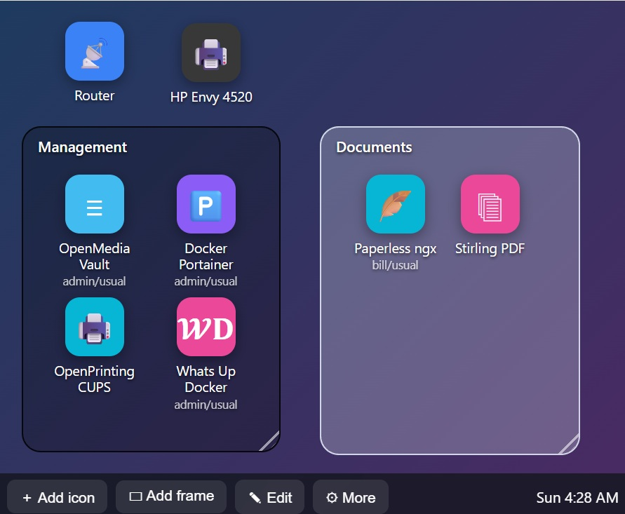

# Home Desktop

A single-file home page for your home server that behaves like a computer desktop. Add icons that link to your services, drag them wherever you like, and group them with colored frames.

AI NOTE: Generated with Claude AI. Contains exactly the features I want, no more or less.



## Features

- Icons that link to your services, with a name, an optional subtitle, and an emoji, letters, or an image as the icon
- Free-form dragging with no grid
- Frames: titled, rounded rectangles with a custom color and fill opacity, always drawn behind icons. Dragging a frame carries along every icon it visibly touches
- Tidy up: nudges icons the smallest distance needed to line them up with their neighbors, and Revert undoes it
- Layout saved on the server so every device sees the same desktop, with a copy kept in each browser as a fallback
- Export and import the layout as a JSON file
- No dependencies, no build step, one HTML file

## Requirements

- A web server. These instructions use nginx on Debian, Ubuntu, or Raspberry Pi OS
- For server-side saving only: nginx with the WebDAV module (`http_dav_module`)

Without server-side saving the page still works. The layout is then stored in each browser separately.

## Install

### 1. Copy the page

Put the HTML file in your web root. This README calls it `desktop.html`; you can name it anything, or use `index.html` to make it your home page.

```
sudo cp desktop.html /var/www/html/desktop.html
```

Open `http://your-server/desktop.html`. You should see the desktop with three example icons. At this point it works, but changes are only remembered in that one browser.

### 2. Enable server-side saving (optional)

This makes the layout shared across all your devices.

**a. Check that nginx has the DAV module**

```
nginx -V 2>&1 | grep -o http_dav_module
```

If that prints nothing, install it. On Debian and Ubuntu: `sudo apt install nginx-extras`.

**b. Create the data directory and layout file**

The layout file gets its own directory so nginx can write there and nowhere else. Your page and the rest of the web root stay read-only to nginx.

```
sudo mkdir -p /var/www/html/data
echo '{}' | sudo tee /var/www/html/data/layout.json
sudo chown -R www-data:www-data /var/www/html/data
```

If nginx runs as a different user, use that user instead of `www-data`. You can check with `grep '^user' /etc/nginx/nginx.conf`.

**c. Add a location block to your nginx `server` block**

For example in `/etc/nginx/sites-enabled/default`:

```nginx
location = /data/layout.json {
    root /var/www/html;
    dav_methods PUT;
    dav_access user:rw group:rw all:r;
    client_max_body_size 1m;
    add_header Cache-Control "no-store";

    # Anyone can read the layout, but only your LAN can write it
    limit_except GET HEAD {
        allow 192.168.0.0/16;
        allow 10.0.0.0/8;
        allow 172.16.0.0/12;
        allow 127.0.0.1;
        allow ::1;
        allow fe80::/10;
        allow fc00::/7;
        # allow 2001:db8:1234:5678::/64;   # your ISP-assigned IPv6 prefix, if needed (see Troubleshooting)
        deny all;
    }
}
```


Test the configuration and reload:

```
sudo nginx -t && sudo systemctl reload nginx
```

**d. Point the page at the file**

Near the top of the script in the HTML file, find this line and set it to match the location above:

```js
const SERVER = "data/layout.json";
```

**e. Verify**

From another machine on your LAN:

```
curl -i -X PUT --data '{"icons":[]}' http://your-server/data/layout.json
```

You should get `204 No Content` (or `201 Created`). Then reload the page. The "⚠ not synced" message should not appear.

## Using it

### Tuning Tidy up

Tidy up lines up icons whose x (or y) positions are within 40 px of each other. To change that, edit the constant in the script:

```js
const ALIGN = 40;
```

## Troubleshooting

If the taskbar shows **⚠ not synced**, hover over it. The tooltip shows the failing request.

| Message | Meaning and fix |
| --- | --- |
| `PUT 405` or `501` | The server isn't accepting PUT for that path. Check that the `location` path matches the `SERVER` value exactly and that the DAV module is installed |
| `PUT 403` | Either the `limit_except` rule rejected your device, or nginx can't write the file. Run `sudo tail -n 5 /var/log/nginx/error.log`: "access forbidden by rule" means the address in `client:` needs an `allow` line, and "Permission denied" means fixing ownership of the `data` directory |
| `PUT 404` or `409` | The `data` directory doesn't exist, or the path is wrong |
| `Failed to fetch` | The request was blocked, for example by a sandboxed preview. Try it on the real server |

**IPv6:** if your device reaches the server over IPv6, the error log shows a public address like `2603:...`. Add that address's first four groups as a `/64` to the `allow` list (for example `allow 2603:8003:2700:3d41::/64;`). Home ISPs sometimes change this prefix, in which case the log shows the new one. Browsing by the server's IPv4 address avoids the issue.

**Layout reverted or looks different on another device:** the page keeps a local copy in each browser and loads the server copy on startup. Make sure no "not synced" message is showing on the device that made the changes.

## Security notes

- Anyone who can reach the page can read the layout, including your service URLs. Don't put secrets in icon URLs.
- Writes are limited to the addresses in the `limit_except` block. To require a password as well, add `auth_basic` and `auth_basic_user_file` inside that block.
- Only the one file, `data/layout.json`, is writable. The page itself isn't writable by nginx.
